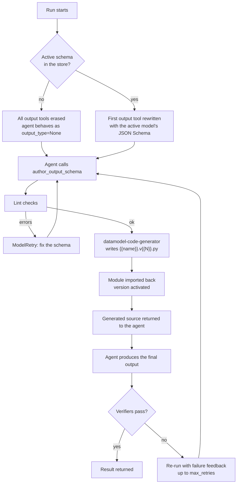

# Dynamic Output

`DynamicOutput` is a [pydantic-ai capability](https://pydantic.dev/docs/ai/capabilities/overview/) that removes the agent's fixed
output type and lets the **agent author its own** — as a JSON Schema that is converted into a real
Pydantic model, stored on disk, versioned, and evolved run after run.

Instead of you deciding up-front what the structured answer looks like, the agent:

1. authors a JSON Schema with the `author_output_schema` tool;
2. receives back the **generated Python module** (so it writes against real Pydantic code, not raw JSON);
3. produces its final answer conforming to that model;
4. gets the model checked by your [verifiers](#verification-and-retries) and, on failure, is re-run with
   the failure messages so it can *evolve* the schema into a new version.

Every version is a plain `<name>.v<version>.py` module on disk, indexed by a `manifest.json` — readable,
diffable, and hand-editable.

Full signatures live in the [DynamicOutput API](dynamic_output_api.md) reference.

## Quick start

```python
from pathlib import Path

from pydantic_ai import Agent

from pydantic_ai_gedanken.capabilities.dynamic_output import DynamicOutput

dynamic_output = DynamicOutput(directory=Path('.output_models'))

agent = Agent(
    'anthropic:claude-sonnet-5',
    capabilities=[dynamic_output],
    # The placeholder gives the capability an output tool to rewrite with the
    # authored schema, so this run can already end with the evolved output type.
    output_type=[str, DynamicOutput.placeholder_output_type()],
)

result = agent.run_sync('Review this task and return a structured verdict: ...')
print(result.output)
```

!!! warning "Always pass `placeholder_output_type()`"
    The capability serves the authored model by **rewriting an existing output tool definition**. Without
    a placeholder in `output_type` there is no tool definition to rewrite, so a model authored during the
    run only takes effect on *later* runs (via [`store.active_output_type()`](#reusing-the-evolved-type)).

    Only the **first** output tool definition is rewritten; any further structured output types are dropped
    while the capability is attached.

## How it works



The two hooks doing the work are
[`prepare_output_tools`][pydantic_ai_gedanken.capabilities.dynamic_output.DynamicOutput.prepare_output_tools]
(erase / serve the output type) and
[`wrap_run`][pydantic_ai_gedanken.capabilities.dynamic_output.DynamicOutput.wrap_run] (verify and retry).

## Authoring tools

The capability contributes a
[`DynamicOutputToolset`][pydantic_ai_gedanken.capabilities.dynamic_output.DynamicOutputToolset] with three
tools, plus static system-prompt guidance describing the workflow.

| Tool | Constant | What it does |
| --- | --- | --- |
| `author_output_schema(name, json_schema)` | `AUTHOR_TOOL_NAME` | Lints the schema, generates a Pydantic model, stores it as a new version, activates it, and returns the generated source. Reusing a `name` **evolves** that schema (version + 1). |
| `list_output_schemas()` | `LIST_TOOL_NAME` | Returns the whole manifest as JSON: versions, class names, statuses, timestamps, last error. |
| `deactivate_output_schema(name)` | `DEACTIVATE_TOOL_NAME` | Marks a schema `inactive` so it stops serving as the output type. |

Schema names must match `^[a-z][a-z0-9_]*$`; the root model class name is derived from it
(`task_review` → `TaskReview`).

### Lint rules

A draft is checked by [`lint_json_schema`][pydantic_ai_gedanken.capabilities.dynamic_output.lint_json_schema]
before any code is generated. Blocking errors come back to the model as a `ModelRetry`; warnings are
appended to the tool result without blocking activation.

=== "Errors (blocking)"

    - The root is not an object schema (`"type": "object"`).
    - The document violates its declared meta-schema (JSON Schema 2020-12 by default).
    - `required` lists properties that are not declared in `properties`.
    - A property value is not a schema object.

=== "Warnings (non-blocking)"

    - The root declares no `properties` (the output type would accept any object).
    - A property has no type constraint (`type`, `$ref`, `enum`, `const`, `anyOf`, `oneOf`, `allOf`).
    - The root has no `title`.
    - The root has no `description`.

Whether the schema actually *converts* into an importable model is decided afterwards by the code
generator, which raises
[`ModelGenerationError`][pydantic_ai_gedanken.capabilities.dynamic_output.ModelGenerationError] — also
surfaced to the model as a retry.

### From schema to Python

Conversion is done by
[`datamodel-code-generator`](https://koxudaxi.github.io/datamodel-code-generator/) pinned to the
`MODEL_PRESET` style, with descriptions turned into docstrings, snake-cased field names, and
`strict_refs=True` so a dangling `$ref` fails loudly instead of silently degrading a field to `Any`.

Given this authored schema:

```json
{
  "type": "object",
  "title": "TaskReview",
  "description": "Structured review of a task.",
  "properties": {
    "summary": { "type": "string", "description": "One-line summary of the task." },
    "risk": { "type": "string", "enum": ["low", "medium", "high"], "description": "Assessed risk level." },
    "blockers": { "type": "array", "items": { "type": "string" }, "description": "Known blockers." }
  },
  "required": ["summary", "risk"]
}
```

the store writes `task_review.v1.py` and hands this source back to the agent:

```python
from __future__ import annotations

from enum import StrEnum

from pydantic import BaseModel, ConfigDict


class Risk(StrEnum):
    """
    Assessed risk level.
    """

    low = 'low'
    medium = 'medium'
    high = 'high'


class TaskReview(BaseModel):
    """
    Structured review of a task.
    """

    model_config = ConfigDict(
        populate_by_name=True,
        use_attribute_docstrings=True,
    )
    summary: str
    """
    One-line summary of the task.
    """
    risk: Risk
    """
    Assessed risk level.
    """
    blockers: list[str] | None = None
    """
    Known blockers.
    """
```

## On-disk layout

`directory` holds one module per version next to the manifest index:

```
.output_models/
├── manifest.json
├── task_review.v1.py
└── task_review.v2.py
```

```json title="manifest.json"
{
  "schemas": [
    {
      "name": "task_review",
      "source_file": "task_review.v2.py",
      "class_name": "TaskReview",
      "version": 2,
      "status": "active",
      "created_at": "2026-07-27T21:17:03.870500+00:00",
      "updated_at": "2026-07-27T21:17:04.210379+00:00",
      "activated_at": "2026-07-27T21:17:04.210379+00:00",
      "last_error": null
    }
  ]
}
```

A schema moves through three statuses — `draft` (just generated), `active` (currently serving as the
output type) and `inactive` (superseded or explicitly deactivated). **At most one schema is active at a
time**: activating one demotes any other.

!!! tip "Hand-editing is supported"
    Older versions are never deleted, and each version is an ordinary Python module. Edit
    `task_review.v2.py` by hand and the change is picked up on the next run — the model cache is keyed by
    file path, mtime and size. A broken edit raises `ModelGenerationError` and leaves the previously
    loaded module in place.

    The manifest is written atomically (temp file + `replace`), and a missing or corrupt `manifest.json`
    reads as "no schemas" rather than crashing.

## Verification and retries

Verifiers are your gate on what the agent is allowed to converge on. Each
[`Verifier`][pydantic_ai_gedanken.capabilities.dynamic_output.Verifier] is a named async function receiving
the **generated Pydantic model** (inspect it via `model.model_fields` or `model.model_json_schema()`) and
returning a [`VerificationResult`][pydantic_ai_gedanken.capabilities.dynamic_output.VerificationResult].

```python
from pathlib import Path

from pydantic import BaseModel
from pydantic_ai import Agent

from pydantic_ai_gedanken.capabilities.dynamic_output import (
    DynamicOutput,
    VerificationResult,
    Verifier,
)


async def requires_name(model: type[BaseModel]) -> VerificationResult:
    ok = 'name' in model.model_fields
    return VerificationResult(passed=ok, message='ok' if ok else "declare a 'name' field")


async def is_documented(model: type[BaseModel]) -> VerificationResult:
    ok = bool(model.__doc__)
    return VerificationResult(passed=ok, message='ok' if ok else 'add a description to the root schema')


agent = Agent(
    'anthropic:claude-sonnet-5',
    capabilities=[
        DynamicOutput(
            directory=Path('.output_models'),
            verifiers=[
                Verifier(name='requires_name', check_fn=requires_name),
                Verifier(name='is_documented', check_fn=is_documented),
            ],
            max_retries=3,
            parallel=True,
        )
    ],
    output_type=[str, DynamicOutput.placeholder_output_type()],
)
```

After the run completes, every verifier runs against the active model (concurrently when `parallel=True`,
which is the default; sequentially in list order otherwise). Then:

- **all pass** — the result is returned and `last_error` is cleared in the manifest;
- **any fail** — the failures are recorded in `last_error`, and the agent is re-run with the message
  history plus a feedback prompt naming each failing check, asking it to evolve the schema under the
  same name and produce the output again. Retry runs skip verification themselves, so there is no
  recursion;
- **still failing after `max_retries`** — a `UserWarning` is emitted and the last result is returned
  anyway. Verification is advisory, not a hard failure.

With an empty `verifiers` list (the default), only the lint checks at authoring time gate the schema and
no retry loop runs.

## Reusing the evolved type

While the capability is attached, the active model *is* the agent's output type. To use it anywhere else
— a downstream consumer agent, a validation step, a serializer — read it from the store:

```python
from pathlib import Path

from pydantic_ai_gedanken.capabilities.dynamic_output import DynamicOutput

dynamic_output = DynamicOutput(directory=Path('.output_models'))

output_type = dynamic_output.store.active_output_type()  # `type[BaseModel] | None`
if output_type is not None:
    consumer = Agent('anthropic:claude-sonnet-5', output_type=output_type)
```

[`SchemaStore`][pydantic_ai_gedanken.capabilities.dynamic_output.SchemaStore] is a plain dataclass over the
directory, so it can also be used standalone — `list_all()`, `get(name)`, `read_source(record)`,
`activate(name)`, `deactivate(name)`.

## Configuration

| Field | Type | Default | Purpose |
| --- | --- | --- | --- |
| `directory` | `Path` | — | Where the `<name>.v<version>.py` modules and `manifest.json` live. |
| `verifiers` | `list[Verifier]` | `[]` | Checks run against the active model after each run. |
| `max_retries` | `int` | `3` | Maximum retry runs when verification fails. |
| `parallel` | `bool` | `True` | Run verifiers concurrently (`asyncio.gather`) or sequentially. |
| `guidance` | `str | None` | `None` | System-prompt guidance on the authoring workflow. `None` uses the built-in text; `''` omits guidance entirely; any other string replaces it. |

The guidance is static and therefore **cache-stable** — it does not change between runs, so it does not
invalidate prompt caching.

!!! note "Not constructible from a spec"
    [`get_serialization_name`][pydantic_ai_gedanken.capabilities.dynamic_output.DynamicOutput.get_serialization_name]
    returns `None`, opting the capability out of spec-based (YAML) construction: `verifiers` hold
    arbitrary Python callables and are not serializable. Wire `DynamicOutput` up in Python.
